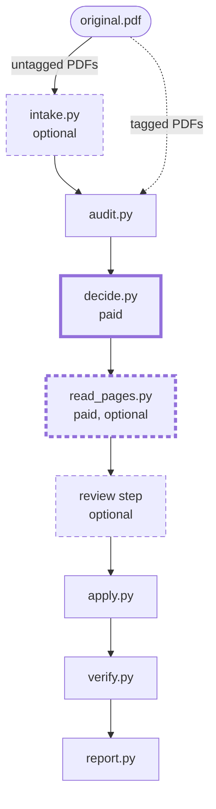

# PDF Accessibility Remediation Pipeline

[](https://github.com/pdf-accessibility-remediation/pdf-accessibility-remediation/actions/workflows/ci.yml)

This pipeline helps make PDF books accessible. The AI (Claude by default, through OpenRouter) reads a short summary of a tagged PDF and returns a **work order**: a JSON list of decisions such as heading levels, alternative text, decorative content to hide (artifacts), the document language and reading-order fixes. The code carries out those decisions on a copy, checks the result and writes a report for a reviewer. The original PDF is never changed.

Two steps can cost money: the AI's work order (`decide.py`) and, for scanned pages that are mostly in Hawaiian, a reading of each page by the AI (`read_pages.py`). Both show an estimate and ask before anything is sent.

## How it works



Paid steps have a thick border, and optional steps a dashed one.

| Step | What it does |
|---|---|
| `intake.py` | OCR and automatic tagging (untagged PDFs only; local tools, free) |
| `audit.py` | a summary of the PDF for the AI, and veraPDF on the original |
| `decide.py` | the AI returns the work order (paid) |
| `read_pages.py` | the AI reads scanned Hawaiian pages whole (paid; only when there are such pages) |
| review step | a reviewer approves or changes each decision (optional: REVIEW=1) |
| `apply.py` | carries out the work order on a copy |
| `verify.py` | veraPDF on the result, and checks that pages and text still match |
| `report.py` | original_remediated.pdf, review.md, review.html, record.json |

Tagged PDFs skip `intake.py`.

**Untagged PDFs** first go through `intake.py`. It uses local tools to add text by OCR where pages have none, then tags the PDF automatically, with checks after each step. Intake makes no AI request. See [Intake: untagged PDFs](docs/intake.md).

**Tagged PDFs** skip intake and go straight to the audit.

The pipeline checks the PDF with veraPDF's WCAG 2.2 machine profile twice: on the original during the audit, and on the result during verification. The report sorts every failed rule into fixed, still failing or newly failing. A newly failing rule may be a problem the remediation caused, so it is flagged for review.

## Setup

The following steps are enough for tagged PDFs. Untagged PDFs also need the intake tools (OCRmyPDF, Tesseract and Java): see [Setup](docs/setup.md), step 2.

1. **Install Python dependencies.** From the `pipeline/` directory, create and activate a virtual environment with Python 3.13 or 3.14 (`python3.14 -m venv .venv` works the same way), then install the requirements. Don't use Python 3.15: pikepdf 10.5.1, which the pipeline pins, has no ready-made Python 3.15 build.
    ```
    python3.13 -m venv .venv
    source .venv/bin/activate
    pip install -r requirements.txt
    ```
    The pipeline requires `pdfplumber 0.11.9` because `lib/plumb_fix.py` patches its internals.

2. **Configure your OpenRouter API key.** Add `OPENROUTER_API_KEY=...` to a `.env` file in `pipeline/` or a parent directory, such as the repository root. Keep `.env` out of version control.

3. **Check your API key.** From `pipeline/`, run:
    ```
    python3 decide.py --check-key
    ```

4. **Install veraPDF.**

    Java 11 or later is required; Java 17 is recommended.
    - **Ubuntu/Debian:**
        ```
        sudo apt install openjdk-17-jre-headless
        ```
    - **macOS with Homebrew:**
        ```
        brew install openjdk@17
        ```
        Follow Homebrew's instructions to make Java discoverable by macOS and your shell. See the [OpenJDK 17 Homebrew formula](https://formulae.brew.sh/formula/openjdk@17) for details.

    - **Other systems:** Follow the [Java 17 installation guide](https://docs.oracle.com/en/java/javase/17/install/).

    Then install veraPDF from `pipeline/`:

    ```
    bash verapdf/install.sh
    ```

    Follow the script's instructions for setting the VERAPDF environment variable, then check the installation:
    ```
    python3 vera.py --check
    ```

    The pipeline checks veraPDF before making a paid AI request. To run without veraPDF, set `VERAPDF=off`; the WCAG checks are then skipped.

5. **Prepare your files.** Sample PDFs are in `samples/tagged/`, `samples/scanned/` and `samples/untagged/`. They are open-access books, listed with their licenses in [samples/README.md](samples/README.md). The prompts the AI is given ship in `prompts/`, so they need no setup. Outputs are written to `runs/<short-name>/<run-label>/` beside `pipeline/`.

    Keep your own PDFs and the `runs/` folder out of version control, particularly when they contain copyrighted material.

## Run

From the repository's `pipeline/` directory, run:

```
bash run_api.sh <original.pdf> <short-name> [run-label]
```

For example:

```bash
bash run_api.sh ../samples/tagged/northkorea.pdf nktest api-run1
```

The short name sets the output folder, `runs/<short-name>/<run-label>/`. The run label is optional and defaults to a timestamp.

The script audits the PDF, displays a cost estimate and available credit, and asks for confirmation before calling the API. It then applies the AI's work order, verifies the result, and generates the review report: `review.md`, which opens with an "Overview" summary (including "Ready to ship?"), and `review.html`, the same run as an offline dashboard. A batch also gets `summary.html`. See [Output files](docs/output-files.md).

A label that already holds a finished run is refused, so use a new label for each new run. If a run stops partway, rerun the same command with the same label: it picks up where it stopped, reusing the audit and any usable reply already paid for.

To retain intermediate files for debugging, set `KEEP=1`:

```
KEEP=1 bash run_api.sh ../samples/tagged/northkorea.pdf nktest api-run2
```

## Documentation

The full documentation, covering setup, run options, batch runs, models, output files, intake, veraPDF verification, and troubleshooting, is available at the [PDF Accessibility Remediation documentation](https://pdf-accessibility-remediation.github.io/) site. Documentation source files are maintained in `docs/` in this repository so documentation changes can be reviewed alongside pipeline changes.

## Automated checks

GitHub Actions runs the following checks:

- **CI** — Compiles the Python sources, checks shell-script syntax, runs the unit tests on Python 3.13 and 3.14, tests intake's handling of synthetic PDFs, and runs `pip-audit` on the pinned dependencies.
- **PDF validation** — When pipeline, prompt or sample files change: runs the audit with veraPDF on a sample PDF, reruns every regression-test book from its saved AI reply and compares the result with the saved baseline, and tests section moves on a real book.
- **Dependency review** — Reviews dependency changes in pull requests and fails on high-severity vulnerabilities.
- **CodeQL** — Performs static security analysis of the Python code on pushes, pull requests, and weekly.
- **Documentation checks** — Checks documentation links and requires documentation changes when `pipeline/` or `prompts/` changes, unless the pull request has the `no-docs-needed` label.

These workflows never make a paid AI request. See [Testing](docs/testing.md#in-ci) for the details.

## Limitations and human review

Automated remediation and validation do not guarantee that a PDF is fully accessible. Machine-checkable rules cannot assess every aspect of accessibility, and the AI's alternative text, heading levels and reading-order decisions may need correcting.

PDF 2.0 is not supported yet. A PDF 2.0 file, or one whose tag tree declares namespaces, is stopped before any paid call or change and goes to a person.

**Review `review.md` and manually inspect the remediated PDF before relying on it.** Pay particular attention to unresolved failures and newly failing rules.
